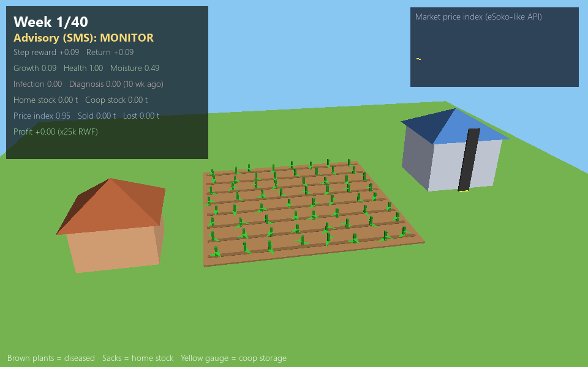
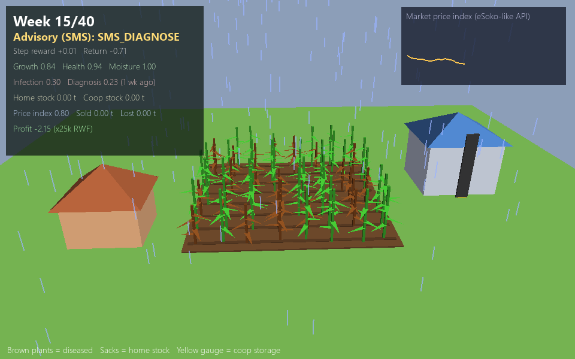
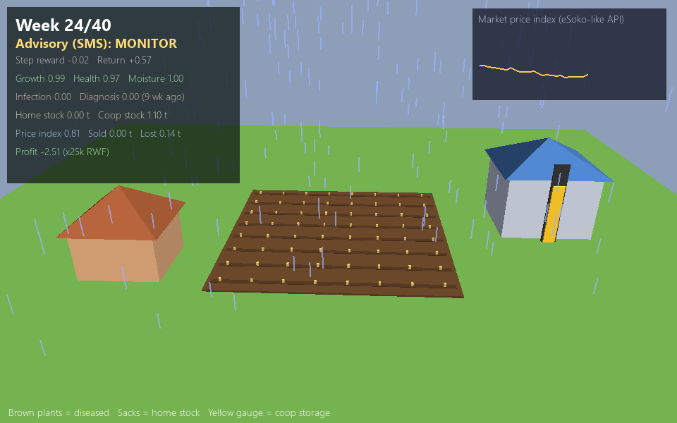
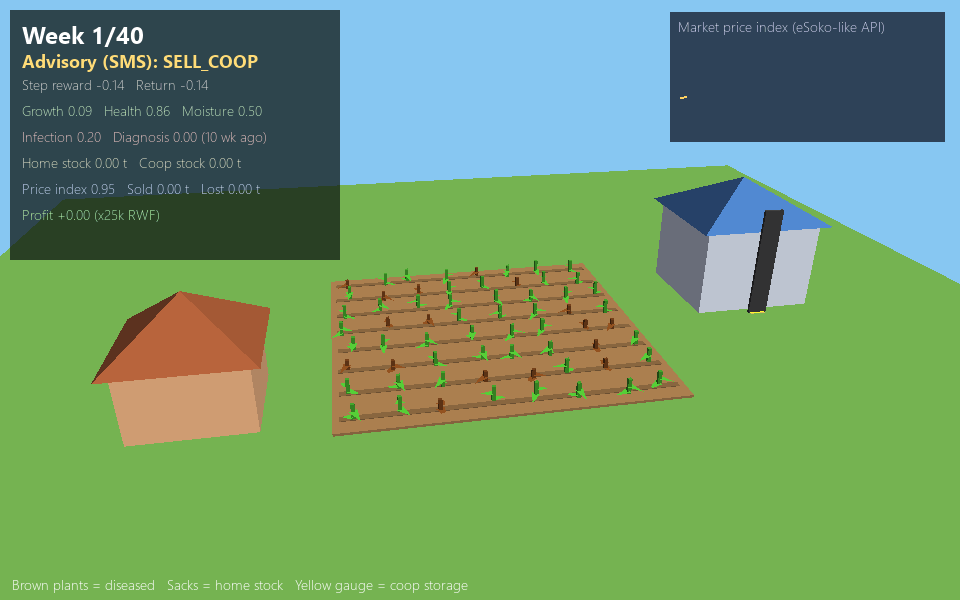
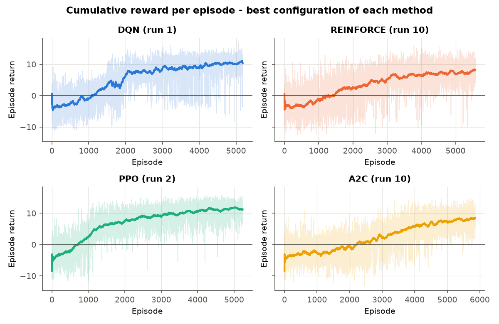
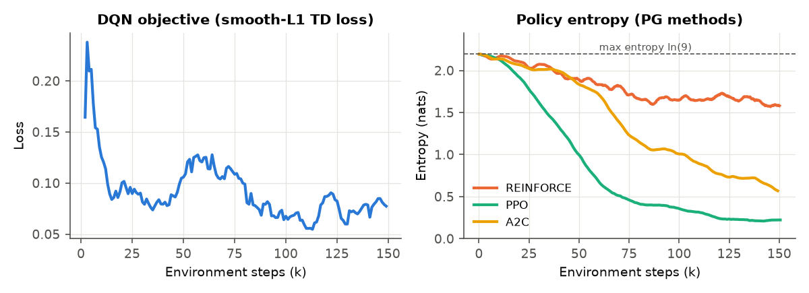
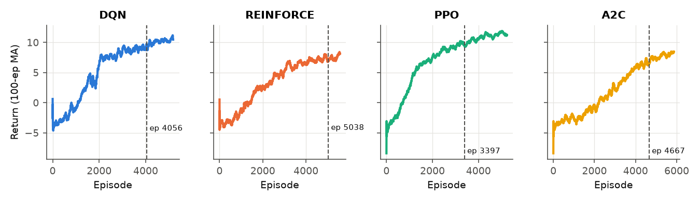
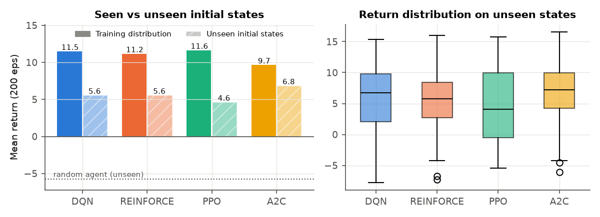
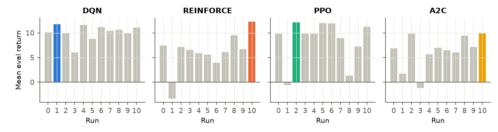

# Smallholder Farm Advisory – RL Summative (DQN vs REINFORCE vs PPO vs A2C)

**Mission:** build ML solutions that reach African smallholder farmers through the tools they already
use (SMS, voice, cooperatives), helping them anticipate demand, reduce losses, self-diagnose crop
diseases and earn fairer incomes.

This project turns that mission into a custom reinforcement-learning environment,
`SmallholderFarmEnv`. An **advisory agent** (an SMS/USSD service) decides each week of a maize season
what the farmer should do: irrigate, fertilise, request an ML disease diagnosis, treat, harvest,
store in the cooperative's hermetic warehouse, or sell locally or through the cooperative. Four
algorithms are trained with **TorchRL** on the same environment and compared.

<p align="center">
  
  <br><em>The best PPO agent running one full season in the 3D OpenGL simulation</em>
</p>

## Quick start (uv only)

```bash
git clone https://github.com/tibyishaka/Ibyishaka_tresor_rl_summative.git
cd Ibyishaka_tresor_rl_summative
uv sync                      # creates .venv from pyproject.toml + uv.lock
uv run main.py               # best trained agent in the 3D OpenGL simulation
```

Other entry points:

| Command | What it does |
| --- | --- |
| `uv run main.py --algo dqn` | run a specific method (`dqn`, `reinforce`, `ppo`, `a2c`) |
| `uv run main.py --random` | random-action demo of the environment (no model) |
| `uv run main.py --scenario unseen` | evaluate on unseen initial states |
| `uv run main.py --headless --record assets/agent.mp4` | record a video without a window |
| `uv run python -m training.dqn_training --sweep` | DQN hyper-parameter sweep (11 runs) |
| `uv run python -m training.pg_training --algo ppo --sweep` | PG sweep (`reinforce`, `ppo`, `a2c`) |
| `uv run python -m training.analysis` | aggregate sweeps, pick best models, draw report figures |
| `uv run pytest` | environment unit tests |

Each step of `main.py` prints the advisory as a JSON message, the format it would take on its way to
an SMS/USSD gateway:
`{"week": 21, "advice": "STORE_COOP", "reward": -0.12, "price": 0.79, "profit": 6.1}`

## Project structure

```text
├── pyproject.toml / uv.lock      # uv-managed dependencies
├── main.py                       # run best agent with 3D visualisation / record video
├── environment/
│   ├── custom_env.py             # SmallholderFarmEnv (Gymnasium API)
│   └── rendering.py              # pygame-ce + PyOpenGL 3D renderer
├── training/
│   ├── common.py                 # TorchRL env wrapper, evaluation, logging
│   ├── dqn_training.py           # DQN (replay buffer, target net, Double-DQN option)
│   ├── pg_training.py            # REINFORCE, PPO (ClipPPOLoss+GAE), A2C (A2CLoss+GAE)
│   └── analysis.py               # sweep tables + report figures
├── models/dqn, models/pg         # saved weights (best_*.pt + every sweep run)
├── logs/                         # per-run episode/update CSVs, sweep CSVs, results_summary.json
├── assets/                       # figures, renders, GIFs
└── tests/                        # pytest checks of the environment
```

## Environment summary

| Item | Definition |
| --- | --- |
| Step | one week; the season lasts up to 40 weeks |
| Actions (Discrete 9) | MONITOR, IRRIGATE, FERTILIZE, SMS_DIAGNOSE, TREAT, HARVEST, STORE_COOP, SELL_LOCAL, SELL_COOP |
| Observation (Box 14, [0,1]) | week, growth, health, soil moisture, rain forecast, visible symptoms, last diagnosis, diagnosis staleness, market price, 4-week demand/price trend, home stock, coop stock, harvested flag, fertiliser effect |
| Reward | sales revenue − input costs − storage fees + 2·Δgrowth + 1.5·harvested tonnes − crop-health loss − 0.2 per invalid action − 3 for crop failure − 1 per unsold tonne at season end |
| Start state | week 0, freshly planted plot, random health (0.85–1), moisture (0.3–0.7), rainfall phase, price-trough week (18–24), 10% chance of early infection |
| Terminal | whole harvest sold · crop failure (health ≤ 0.1) · end of season (week 40) |
| Unseen scenario | lower health (0.6–0.85), drought or waterlogged soil, price trough at weeks 14–17 or 25–28, 50% pre-infected |

Hidden dynamics the agent must learn: disease is invisible until it is advanced unless the farmer
requests an SMS diagnosis; produce stored at home loses 7% a week while cooperative storage loses 1%;
local traders pay 70% of the market price; prices crash at harvest and peak in the lean season.

## Visualisation

The environment is rendered in 3D with pygame-ce and PyOpenGL. Plant height shows crop growth, brown
plants are diseased, soil colour follows moisture and rain falls as particles. Sacks next to the house
are home stock, and the yellow gauge on the cooperative warehouse shows cooperative stock. The HUD shows
the SMS advice sent this week, the reward, the stocks and the market price curve.

<p align="center">
  
  
  <br><em>Left: mid-season, with the agent requesting an SMS diagnosis. Right: after harvest, with the grain in cooperative storage.</em>
</p>

<p align="center">
  
  <br><em>A random agent for comparison: without sensible advice the crop fails within a few weeks</em>
</p>

## Results

See `logs/results_summary.json`, the `logs/*_sweep.csv` files and the report for the full analysis.

Best configuration per method: greedy policy, 200 new seeds. The hand-written expert heuristic scores +12.1
on seen states and +7.3 on unseen states; a random agent scores −4.4 and −5.8.

| Method | Best run | Seen states | Unseen states | Episodes to converge |
| --- | --- | --- | --- | --- |
| DQN | 1 (lr 5e-4) | +11.49 ± 2.21 | +5.56 | 4,056 |
| REINFORCE | 10 (V(s) baseline, entropy 0.05, 128×128) | +11.17 ± 3.54 | +5.56 | 5,038 |
| PPO | 2 (lr 1e-3) | **+11.64 ± 2.78** | +4.63 | **3,397** |
| A2C | 10 (lr 1e-3, 128-step rollouts, λ 0.95) | +9.65 ± 2.39 | **+6.85** | 4,667 |

All four agents learned to harvest at maturity, store the grain in the cooperative's hermetic warehouse and
sell through the cooperative in the lean season (no best agent ever sold to a local trader).

### Episode returns during training

Every method starts near −4 (crop failures, wasted inputs) and ends clearly positive. PPO rises most
smoothly to the highest plateau, and REINFORCE has the noisiest returns.



### Training stability

The DQN TD loss stays bounded thanks to the target network. PPO and A2C become near-deterministic
(entropy falls to about 0.25 nats), while the best REINFORCE run stays exploratory (about 1.6 nats).



### Episodes to converge

The dashed line marks the episode after which the 100-episode moving average stays near its final level.
PPO converges first (3,397 episodes) and REINFORCE last (5,038 episodes).



### Generalisation to unseen initial states

Every agent loses about half its return on unseen starts (weaker crops, drought, shifted price trough)
but stays far above the random agent. A2C generalises best and PPO worst.



### Hyper-parameter sweeps

Mean evaluation return of all 11 runs per method; the best run is coloured.




